# Activity Diagram - Inject & Collect

This document presents the main activity flow of the Inject & Collect project.

The activity diagram uses the simplified project view:

- Company discovery is handled through Apollo.
- Website research and extraction are handled by SmartScraperAI and Gemini.
- Persona enrichment includes contact APIs and Apify lead scraping.
- Intent signals include API-based and website-based signal collection.
- Final data is saved locally and persisted in Neo4j.

## Main Activity Diagram

```mermaid
flowchart TD
    Start([Start]) --> Config[Load pipeline settings<br/>industry, location, company limit]
    Config --> Init[Initialize main services<br/>Discovery, AI research, Persona, Intent, Database]

    Init --> Search[Search companies by industry and location]
    Search --> Candidates{Candidate companies found?}

    Candidates -- No --> NoCompanies[Show no companies found]
    NoCompanies --> End([End])

    Candidates -- Yes --> CompanyLoop[Select next company]

    CompanyLoop --> Enrich[Enrich company profile with Apollo]
    Enrich --> WebsiteCheck{Website available?}

    WebsiteCheck -- Yes --> WebResearch[Analyze company website]
    WebResearch --> Scrape[Scrape pages and collect evidence]
    Scrape --> PDFCheck{Financial PDFs found?}
    PDFCheck -- Yes --> AnalyzePDF[Analyze PDFs and extract financial data]
    PDFCheck -- No --> ExtractAI[Extract structured company data with AI]
    AnalyzePDF --> ExtractAI
    ExtractAI --> MissingCheck{Critical fields missing?}

    MissingCheck -- Yes --> MorePages[Select and visit targeted pages]
    MorePages --> ExtractAI

    MissingCheck -- No --> SaveAI[Save raw text and AI JSON]
    SaveAI --> Merge[Merge Apollo data with AI data]

    WebsiteCheck -- No --> Fallback[Use Apollo profile as fallback]
    Fallback --> SaveMerged[Save merged or fallback company profile]
    Merge --> SaveMerged

    SaveMerged --> DomainCheck{Domain available?}

    DomainCheck -- Yes --> Persona[Discover and enrich personas]
    Persona --> Leads[Collect Apify leads]
    Leads --> MergeContacts[Merge and normalize personas and leads]
    MergeContacts --> SavePersonas[Save persona and lead data]

    DomainCheck -- No --> IntentCheck{Intent signal collection enabled?}
    SavePersonas --> IntentCheck

    IntentCheck -- Yes --> IntentAPI[Collect API-based intent signals<br/>jobs and news]
    IntentAPI --> IntentWeb[Extract website-based intent signals]
    IntentWeb --> MergeIntent[Merge intent signals]
    MergeIntent --> SaveIntent[Save intent signal data]

    IntentCheck -- No --> MoreCompanies{More companies to process?}
    SaveIntent --> MoreCompanies

    MoreCompanies -- Yes --> CompanyLoop
    MoreCompanies -- No --> Persist[Persist all collected data in Neo4j]

    Persist --> StoreCompanies[Store company profiles]
    StoreCompanies --> StoreMerged[Store merged profiles]
    StoreMerged --> StorePersonas[Store personas and leads]
    StorePersonas --> StoreIntent[Store intent signals]
    StoreIntent --> Success[Pipeline completed successfully]
    Success --> End
```

## Activity Summary

| Activity | Description |
|---|---|
| Load pipeline settings | Reads the target industry, location, and company limit |
| Search companies | Finds matching companies using Apollo |
| Enrich company profile | Retrieves detailed Apollo information for each company |
| Analyze website | Scrapes the company website and extracts evidence |
| Extract structured data | Uses AI to transform website evidence into structured company data |
| Merge data | Combines Apollo data with AI-extracted data |
| Discover personas | Finds decision-makers and enriches their contact information |
| Collect Apify leads | Adds extra lead records from Apify |
| Collect intent signals | Detects jobs, news, hiring, expansion, and business signals |
| Persist data | Stores companies, profiles, personas, leads, and intent signals in Neo4j |

