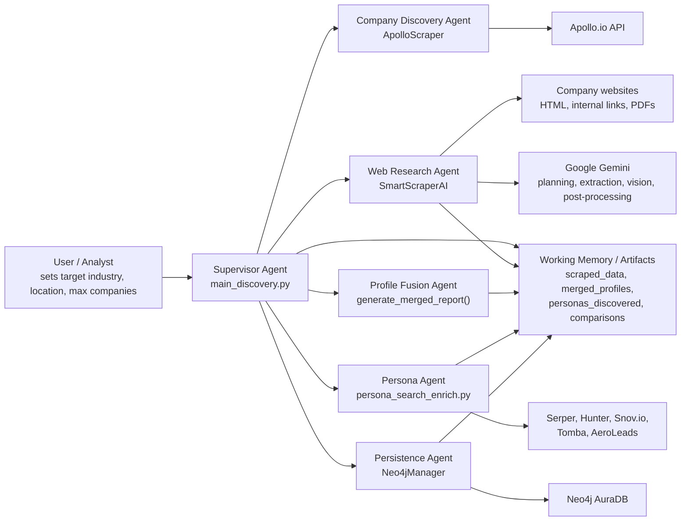
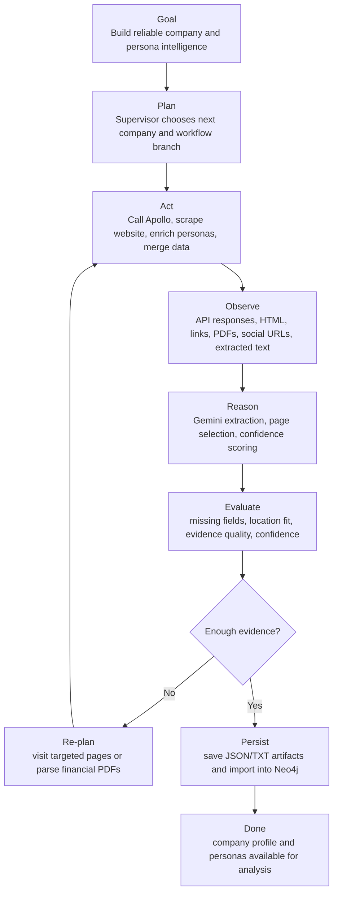
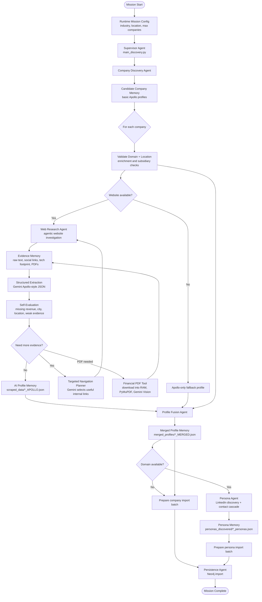
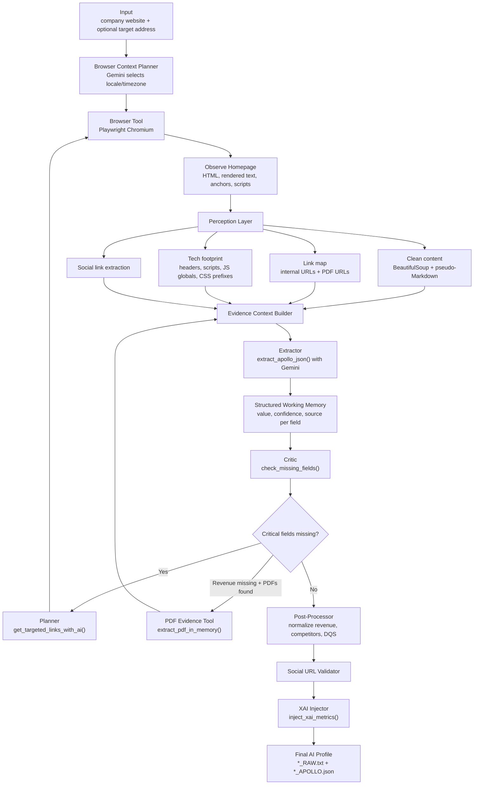
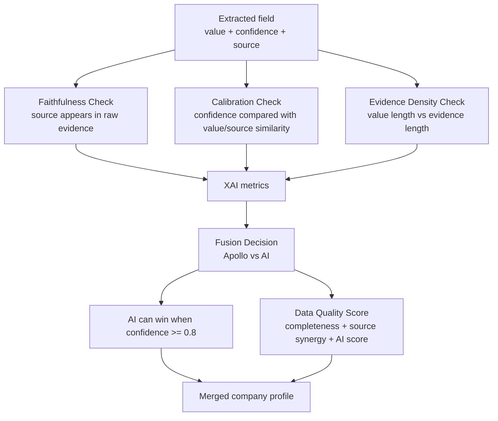
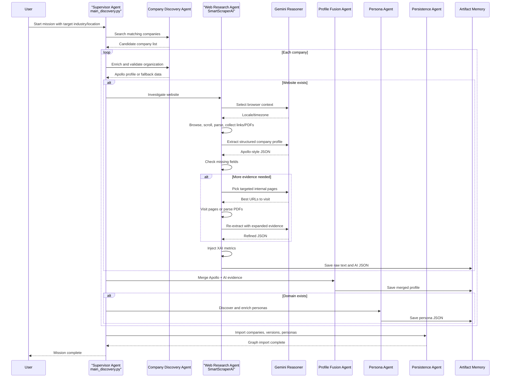

# Inject & Collect - Agentic System Architecture

This document reframes the project from `ARCHITECTURE_DIAGRAM.md` as an agentic data-enrichment system. Instead of showing only modules and infrastructure, it highlights the goal loop, reasoning components, tool use, memory/state, evaluation, and handoffs between specialized agents.

## 1. Agentic System Context

## 2. Agent Roles And Responsibilities

| Agentic Component | Code Owner | Goal | Tools | Output |
|---|---|---|---|---|
| Supervisor Agent | `main_discovery.py` | Orchestrate the full enrichment mission for a target market | Python runtime, config, all downstream modules | Completed company/persona import workflow |
| Company Discovery Agent | `apollo_scraper.py` / `ApolloScraper` | Find and validate companies matching industry/location criteria | Apollo search and organization enrichment APIs | Normalized Apollo company profiles |
| Web Research Agent | `smart_scraper_ai.py` / `SmartScraperAI` | Autonomously inspect websites and extract Apollo-style company facts | Playwright, BeautifulSoup, requests, PyMuPDF, PIL, Gemini text and vision | `*_RAW.txt` and `*_APOLLO.json` |
| Profile Fusion Agent | `generate_merged_report()` | Merge Apollo and AI evidence into one trusted profile | Confidence rules, data quality score logic | `*_MERGED.json` |
| Persona Agent | `persona_search_enrich.py` | Discover likely people and enrich their contact data | Serper, Hunter, Snov.io, Tomba, AeroLeads | `*_personas.json` |
| Persistence Agent | `database_manager.py` / `Neo4jManager` | Convert enriched profiles into graph entities and relationships | Neo4j driver, Cypher import methods | `Company`, `Version`, `Persona`, and relationship nodes |

## 3. Agentic Control Loop

The strongest agentic loop lives inside `SmartScraperAI`: it observes a website, extracts facts, evaluates missing or weak fields, asks Gemini to plan targeted navigation, acts by visiting new pages or PDFs, then reruns extraction with better evidence.

## 4. Multi-Agent Pipeline

## 5. Web Research Agent Internals

## 6. Agent Memory Model

```mermaid
flowchart LR
    subgraph ShortTerm["Short-Term Working Memory"]
        CurrentCompany["Current company object"]
        EvidenceContext["Current website evidence context"]
        MissingFields["Missing field list"]
        SeenURLs["Seen URL set"]
        CandidateLinks["Candidate internal links"]
    end

    subgraph ArtifactMemory["Artifact Memory"]
        RawFiles["scraped_data/*_RAW.txt"]
        AIJson["scraped_data/*_APOLLO.json"]
        MergedJson["merged_profiles/*_MERGED.json"]
        PersonaJson["personas_discovered/*_personas.json"]
        Comparisons["comparisons/*"]
    end

    subgraph GraphMemory["Long-Term Graph Memory"]
        Company["Company nodes"]
        Version["Version nodes"]
        Persona["Persona nodes"]
        Edges["CURRENT, ARCHIVED, OWNS, WORKS_AT"]
    end

    ShortTerm --> ArtifactMemory
    ArtifactMemory --> GraphMemory
```

## 7. Tool Registry

| Tool Class | Concrete Tool | Used By | Agentic Purpose |
|---|---|---|---|
| Search API | Apollo organization search | Company Discovery Agent | Find candidate companies |
| Enrichment API | Apollo organization enrichment | Company Discovery Agent | Validate domain, HQ, size, revenue, ownership |
| Browser | Playwright Chromium | Web Research Agent | Act on the web like a research worker |
| HTML Parser | BeautifulSoup + regex | Web Research Agent | Convert noisy pages into usable evidence |
| LLM Text Reasoner | Gemini text models | Web Research Agent | Extract schema, choose pages, post-process fields |
| Vision Reasoner | Gemini vision | Web Research Agent | Read low-text PDF page images |
| PDF Parser | requests + PyMuPDF + PIL | Web Research Agent | Extract financial evidence without storing PDFs on disk |
| People Search | Serper LinkedIn query | Persona Agent | Discover likely employee/persona records |
| Contact Enrichment | Hunter, Snov.io, Tomba, AeroLeads | Persona Agent | Fill email, phone, title, LinkedIn fields |
| Graph Store | Neo4j AuraDB | Persistence Agent | Persist enriched intelligence as connected entities |
| File Store | Local JSON/TXT folders | All agents | Share state and audit evidence between stages |

## 8. Evaluation And Guardrails

Agentic safeguards already present in the project:

| Guardrail | Implementation | Why It Matters |
|---|---|---|
| Missing-field critique | `check_missing_fields()` | Prevents stopping after weak homepage evidence |
| Targeted page planning | `get_targeted_links_with_ai()` | Directs the browser toward useful pages instead of crawling blindly |
| Evidence-carrying fields | Gemini schema prompt asks for `value`, `confidence`, and `source` | Makes extracted facts auditable |
| XAI injection | `inject_xai_metrics()` | Adds field-level trust signals |
| Confidence-based merge | `generate_merged_report()` | Reduces blind overwrites between Apollo and AI data |
| PDF in-memory processing | `extract_pdf_in_memory()` | Avoids storing financial PDFs by default |
| Fallback profiles | `main_discovery.py` fallback branches | Keeps the mission running when a provider or website fails |

## 9. Agentic Sequence Diagram

## 10. Agentic Components Summary

| Agentic Layer | Project Implementation |
|---|---|
| Goal | Build reliable company and persona profiles for a target market |
| Supervisor | `main_discovery.py` controls the mission, loops, fallbacks, and imports |
| Perception | Playwright page rendering, HTML parsing, link extraction, PDF parsing, social link extraction |
| Reasoning | Gemini extraction, browser context selection, targeted link planning, post-processing |
| Action | API calls, browser navigation, PDF download into RAM, provider cascade calls, Neo4j writes |
| Memory | In-process company objects, seen URLs, evidence context, JSON/TXT artifacts, Neo4j graph |
| Evaluation | Missing-field checks, confidence scores, source evidence, XAI metrics, data quality score |
| Handoffs | Apollo profile -> AI profile -> merged profile -> personas -> graph import |

## 11. Improvement Opportunities For A More Explicit Agent System

| Area | Current State | Possible Agentic Upgrade |
|---|---|---|
| Planning | Planning exists mainly inside website navigation | Add a mission planner that records step plans per company |
| Memory | Artifacts are stored as files and Neo4j nodes | Add a run/session memory object with trace IDs across all stages |
| Tool registry | Tools are called directly by modules | Create a typed tool interface for browser, APIs, PDF, and database operations |
| Critic | Critique focuses on missing fields and XAI metrics | Add a final verifier agent that checks contradictions across Apollo, website, and persona evidence |
| Observability | Logs are mostly print/error handling | Add structured agent traces: goal, action, observation, decision, confidence |
| Human review | User starts the process and reads outputs | Add optional review gates for low-confidence profiles or personal contact data |
