# Inject & Collect - Full Architecture Diagram

This document describes the architecture of the current project based on the Python modules, Docker setup, local data folders, and enrichment scripts in this repository.

## 1. System Context

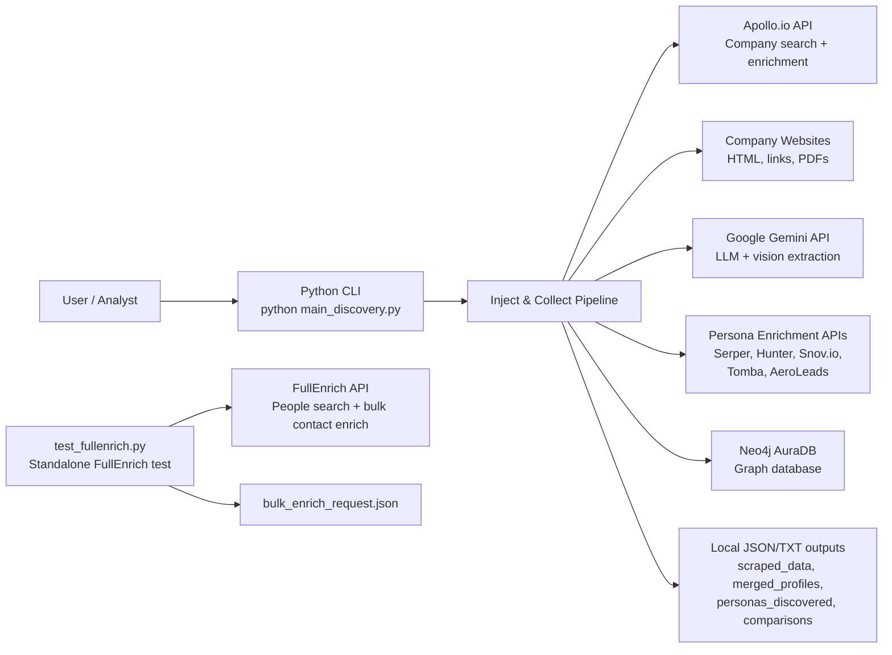

## 2. High-Level Component Architecture

```mermaid
flowchart TB
    subgraph Runtime["Runtime Layer"]
        Main["main_discovery.py<br/>Orchestration engine"]
        Docker["Dockerfile / docker-compose.yml<br/>Container runtime"]
    end

    subgraph Discovery["Company Discovery"]
        ApolloScraper["apollo_scraper.py<br/>ApolloScraper"]
        Search["search_companies()<br/>industry + location filters"]
        Enrich["enrich_organization()<br/>domain enrichment + subsidiary check"]
        Format["format_org_data()<br/>normalize Apollo fields"]
    end

    subgraph AI["AI Web Scraping + Extraction"]
        Smart["smart_scraper_ai.py<br/>SmartScraperAI"]
        Browser["Playwright Chromium<br/>headless browsing + scrolling"]
        Parse["BeautifulSoup + regex<br/>clean HTML + tech signatures"]
        PDF["PyMuPDF + PIL<br/>In-memory PDF financial extraction<br/>PDF bytes kept in RAM"]
        LLM["Gemini models<br/>structured Apollo-style JSON"]
        XAI["XAI metrics<br/>faithfulness, calibration, evidence density"]
    end

    subgraph Fusion["Data Fusion"]
        Merge["generate_merged_report()<br/>Apollo + AI merge"]
        Confidence["Confidence rules<br/>AI wins when confidence >= 0.8"]
        DQS["Data quality score<br/>completeness + source synergy + AI score"]
    end

    subgraph Persona["Persona Discovery + Enrichment"]
        PersonaModule["persona_search_enrich.py"]
        Serper["Serper search<br/>LinkedIn/persona discovery"]
        Cascade["Contact cascade<br/>Hunter -> Snov.io -> Tomba -> AeroLeads"]
        Flatten["Flatten + normalize<br/>email, phone, title, LinkedIn"]
    end

    subgraph Persistence["Persistence Layer"]
        DB["database_manager.py<br/>Neo4jManager"]
        ImportCompany["bulk_import_companies()<br/>Apollo profiles"]
        ImportMerged["import_merged_profiles()<br/>merged profiles"]
        ImportPersona["import_personas()<br/>persona nodes"]
        LocalFiles["Local files<br/>raw text + JSON snapshots"]
    end

    Main --> ApolloScraper
    ApolloScraper --> Search
    ApolloScraper --> Enrich
    ApolloScraper --> Format

    Main --> Smart
    Smart --> Browser
    Smart --> Parse
    Smart --> PDF
    Smart --> LLM
    Smart --> XAI

    Main --> Merge
    Merge --> Confidence
    Merge --> DQS

    Main --> PersonaModule
    PersonaModule --> Serper
    PersonaModule --> Cascade
    Cascade --> Flatten

    Main --> DB
    DB --> ImportCompany
    DB --> ImportMerged
    DB --> ImportPersona

    Smart --> LocalFiles
    Merge --> LocalFiles
    PersonaModule --> LocalFiles
```

## 3. End-to-End Data Flow

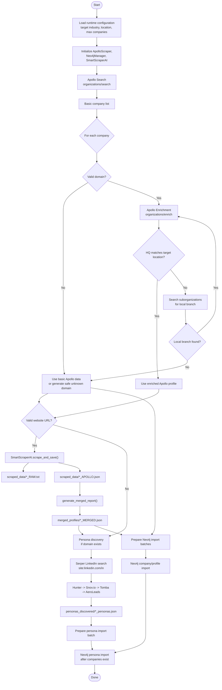

## 4. SmartScraperAI Internal Flow

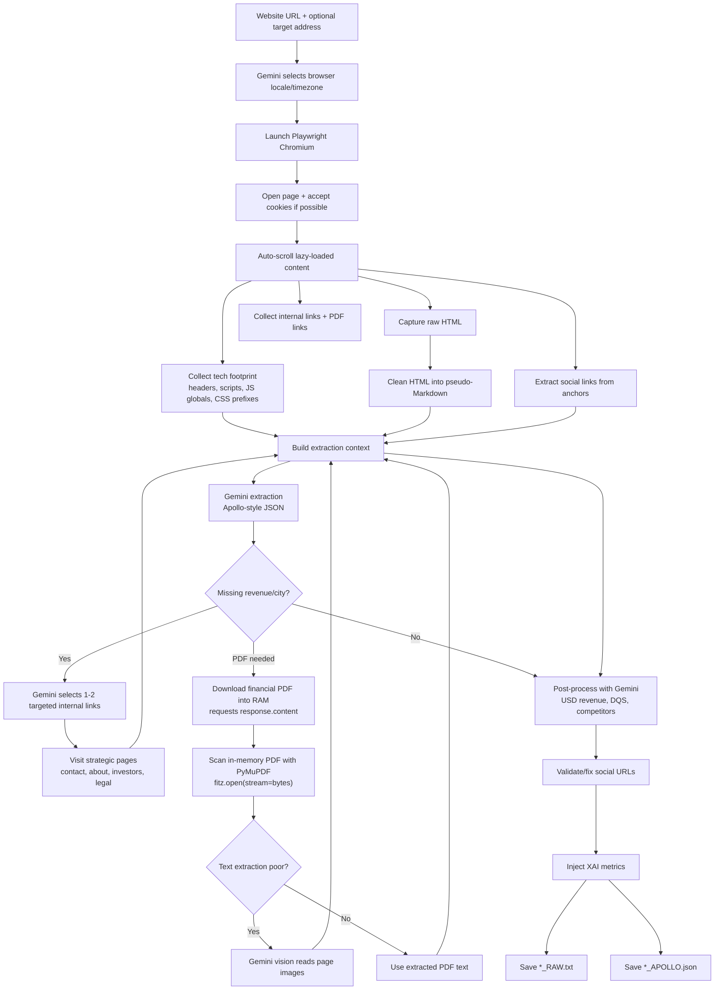

## 5. Agentic Workflow

The project uses an agentic workflow inside `smart_scraper_ai.py`. Instead of scraping only one page and extracting whatever is immediately visible, `SmartScraperAI` acts like a small autonomous research agent:

1. It opens the target website with Playwright.
2. It collects the homepage content, technical footprint, social links, internal links, and potential financial PDF links.
3. It asks Gemini to extract a structured Apollo-style company profile.
4. It checks whether critical fields are missing or weak, especially exact revenue and targeted location.
5. If important fields are missing, it asks Gemini to choose the next best internal pages to visit, such as `Contact`, `About`, `Investors`, `Financials`, `Annual Report`, or `Legal`.
6. It visits those pages, adds the new evidence to the context, and runs extraction again.
7. If financial PDFs are found and revenue is still missing, it downloads the PDF into RAM, parses it in memory, and adds financial evidence to the extraction context.
8. It post-processes the result with Gemini to normalize revenue into USD, estimate data quality, and infer competitors.
9. It validates social links and injects XAI metrics before saving the final JSON.

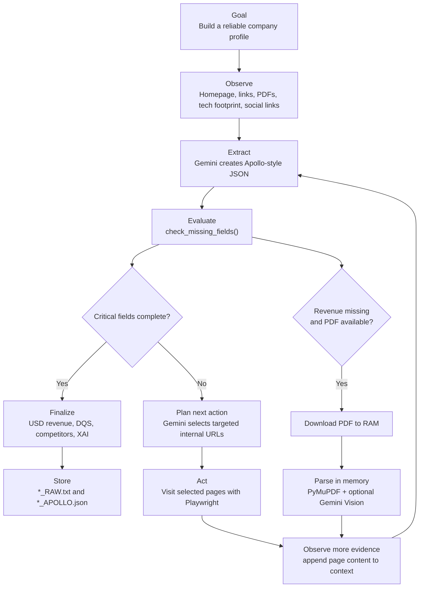

Agentic parts in the code:

| Agentic Capability | Implementation |
|---|---|
| Goal-directed extraction | `extract_apollo_json()` uses a strict Apollo-style schema prompt |
| Self-evaluation | `check_missing_fields()` detects weak or missing critical fields |
| Planning next steps | `get_targeted_links_with_ai()` asks Gemini which internal URLs are most useful |
| Acting on the plan | `scrape_and_save()` navigates selected URLs with Playwright |
| Iterative refinement | The extraction loop reruns after new pages are added to context |
| Tool use | Playwright, requests, PyMuPDF, PIL, Gemini text, Gemini vision |
| Evidence-aware output | Each extracted field includes `value`, `confidence`, and `source` |

## 6. XAI In SmartScraperAI

`SmartScraperAI` includes explainability logic so the project can evaluate not only what the AI extracted, but also how trustworthy the extraction is. The prompt asks Gemini to return every important field with:

| Field Metadata | Meaning |
|---|---|
| `value` | The extracted company data |
| `confidence` | Gemini's confidence score from `0.0` to `1.0` |
| `source` | The exact evidence text used to justify the value |

After Gemini returns the structured JSON, `inject_xai_metrics()` recursively adds an `xai_metrics` object to fields that contain confidence and source evidence.

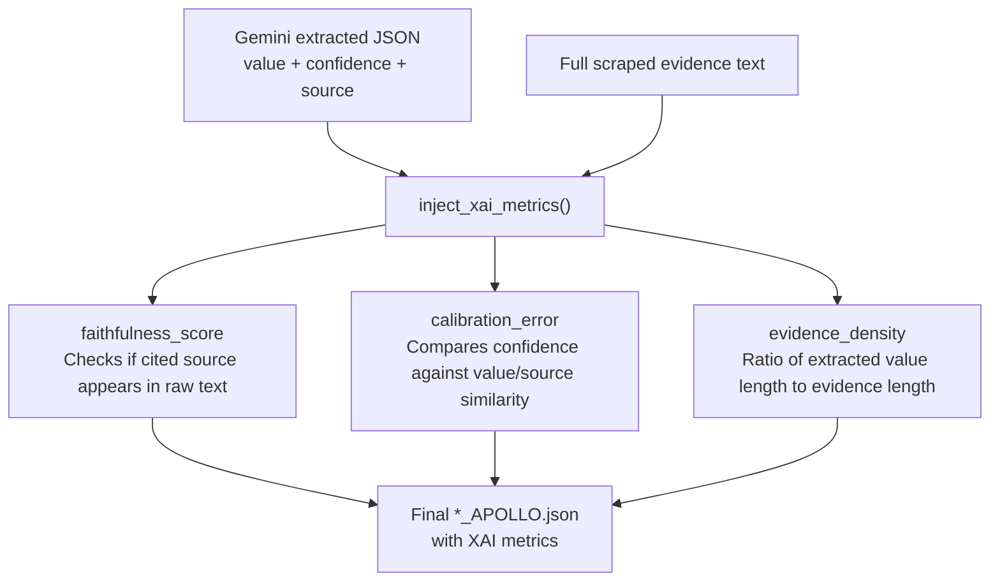

XAI metrics used:

| Metric | How It Works | Why It Matters |
|---|---|---|
| `faithfulness_score` | Returns `1` if the cited source text is found in the scraped evidence, otherwise `0` | Helps detect unsupported or hallucinated claims |
| `calibration_error` | Compares Gemini confidence to text similarity between extracted value and cited source | Highlights overconfident or under-supported fields |
| `evidence_density` | Measures how compact or broad the cited evidence is relative to the extracted value | Helps identify vague evidence versus precise evidence |

This means the project has an explainable enrichment layer: every AI-enriched field can carry a confidence score, a source citation, and extra quality metrics. Those metrics are later available in the saved `scraped_data/*_APOLLO.json` files and can support reporting, debugging, or quality comparison.

## 7. Persona Enrichment Flow

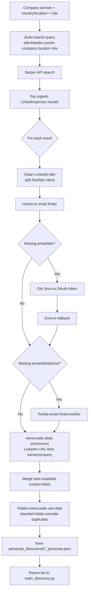

## 8. Neo4j Graph Model

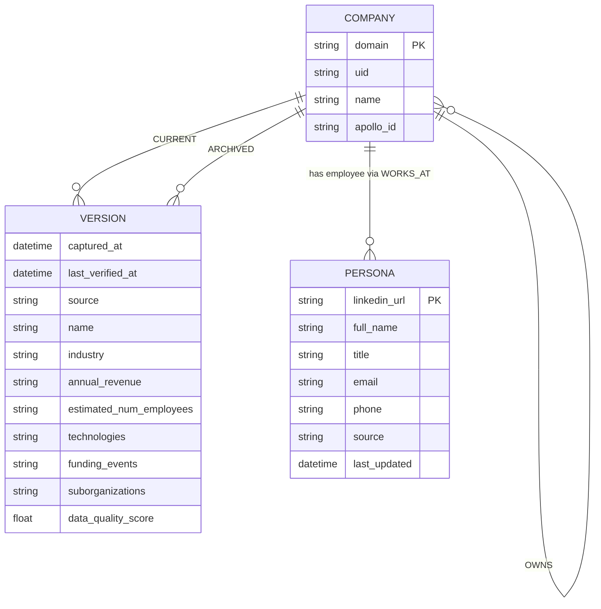

Relationship semantics:

| Relationship | Direction | Meaning |
|---|---|---|
| `(:Company)-[:CURRENT]->(:Version)` | Company to Version | Latest active profile snapshot |
| `(:Company)-[:ARCHIVED]->(:Version)` | Company to Version | Historical profile snapshot after changes |
| `(:Company)-[:OWNS]->(:Company)` | Parent to child | Parent/subsidiary hierarchy |
| `(:Company)-[:OWNED_BY]->(:Company)` | Child to parent | Reverse hierarchy edge |
| `(:Persona)-[:WORKS_AT]->(:Company)` | Persona to Company | Discovered/enriched person belongs to company |

## 9. Local File Architecture

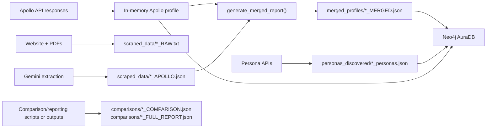

Folder purpose:

| Folder/File | Role |
|---|---|
| `scraped_data/` | Raw website text and Gemini Apollo-style extraction JSON |
| `merged_profiles/` | Final company profiles after Apollo + AI fusion |
| `personas_discovered/` | Persona/contact enrichment results per company |
| `comparisons/` | Data-quality comparison and report artifacts |
| Financial PDFs | Not stored on disk by default; downloaded into RAM and parsed in memory by `SmartScraperAI.extract_pdf_in_memory()` |
| `archive/` | Historical experiments and vendor-specific tests |
| `gemini_test/` | Gemini model testing utilities |
| `test_fullenrich.py` | Standalone FullEnrich search/bulk-enrichment experiment |
| `Dockerfile` | Python 3.11 runtime with Playwright Chromium support |
| `docker-compose.yml` | App container, mounted output directories, optional local Neo4j template |

## 10. Deployment View

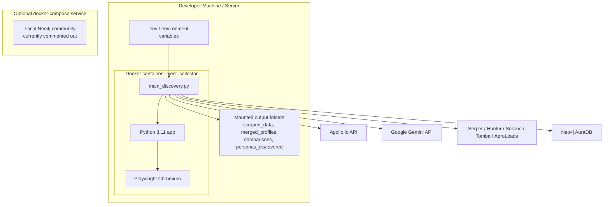

## 11. Main Runtime Sequence

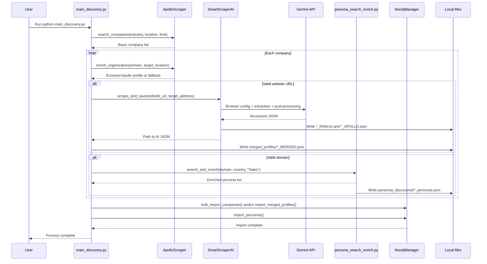

## 12. Notes And Risks

The current project architecture is functional, but there are a few important engineering notes:

| Area | Current State | Recommendation |
|---|---|---|
| Secrets | Several scripts contain hardcoded API keys/credentials | Move all secrets to `.env` and rotate exposed keys |
| Configuration | `TARGET_INDUSTRY`, `TARGET_LOCATION`, and keys are hardcoded in scripts | Centralize config through environment variables or CLI arguments |
| Error handling | Many integrations catch exceptions and continue | Add structured logging and per-provider error reporting |
| Rate limits | Persona cascade calls multiple APIs per result | Add retry/backoff and provider-specific rate-limit controls |
| Data privacy | Persona enrichment stores personal contact data | Add compliance review, retention policy, and access controls |
| Testing | Main pipeline is integration-heavy | Add unit tests for formatting, merge rules, and Neo4j payload preparation |
