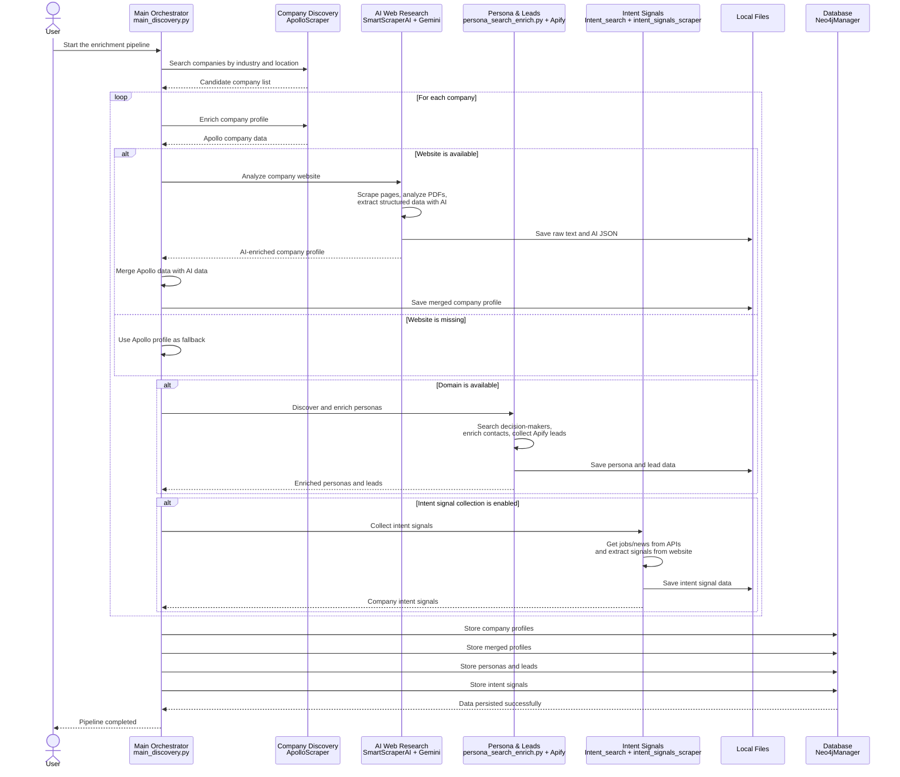

# Sequence Diagram - Inject & Collect

This document presents a simplified sequence diagram for the Inject & Collect project using only the principal actors.

The diagram assumes the target architecture where:

- Apify lead scraping is integrated into the Persona & Leads module.
- `Intent_search.py` and `intent_signals_scraper.py` are integrated into the Intent Signals module.
- Companies, merged profiles, personas, leads, and intent signals are persisted in the database.

## Main Sequence Diagram

## Principal Actors

| Actor | Includes | Responsibility |
|---|---|---|
| User | Analyst / operator | Starts the pipeline and defines the target market |
| Main Orchestrator | `main_discovery.py` | Coordinates all project phases |
| Company Discovery | `ApolloScraper` | Finds and enriches companies through Apollo |
| AI Web Research | `SmartScraperAI`, Gemini | Scrapes websites, analyzes PDFs, extracts structured company data |
| Persona & Leads | `persona_search_enrich.py`, Apify | Discovers people, enriches contacts, and collects lead data |
| Intent Signals | `Intent_search.py`, `intent_signals_scraper.py` | Collects hiring, news, expansion, and business intent signals |
| Local Files | `scraped_data`, `merged_profiles`, `personas_discovered`, `intent_signals_data` | Stores intermediate and final JSON/TXT artifacts |
| Database | `Neo4jManager`, Neo4j | Persists companies, profiles, personas, leads, and intent signals |

