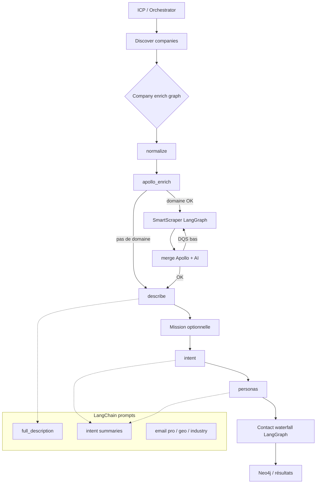

# Rapport — Migration LangGraph / LangChain (Inject & Collect)

## 1. Synthèse

Objectif : rendre le pipeline **lisible et branché** (orchestration) avec **LangGraph**, et améliorer la **qualité des prompts LLM** avec **LangChain** — sans refonte MCP ni gros graph Intent.

| Zone | Choix | Fichier(s) | Flag |
|---|---|---|---|
| SmartScraper (boucle agentique) | **LangGraph** | `smart_scraper_graph.py` + `smart_scraper_ai.py` | `USE_SCRAPER_GRAPH` |
| Supervisor company | **LangGraph** | `company_supervisor_graph.py` + `main_discovery.py` | `USE_COMPANY_GRAPH` |
| Waterfall contacts personas | **LangGraph** | `persona_contact_waterfall_graph.py` | `USE_CONTACT_GRAPH` |
| Helpers LLM (prompts) | **LangChain** | `llm_helpers.py` (sur `llm_provider.py`) | — |

**Principe de séparation**

- **LangGraph** = *quand* on branche (état, conditions, retries, cascades API).
- **LangChain** = *comment* on parle au LLM (templates system/user, variables).
- **Évité** : refonte MCP, graph Intent monolithique (peu de gain).

---

## 2. Pourquoi LangGraph vs LangChain ?

| Besoin | Outil | Raison |
|---|---|---|
| Boucle observe → extract → gaps → navigate → PDF | **LangGraph** | État + arêtes conditionnelles + profondeur |
| Pipeline company (Apollo → scrape? → merge → re-scrape DQS?) | **LangGraph** | Branches métier, pas un “agent tools” LLM |
| Cascade contacts (local → Apollo sync → waterfall phone/email) | **LangGraph** | Cascade d’APIs déterministe |
| Description / intent / email pro / geo matching | **LangChain** | Qualité & structure des prompts |
| Router ESPRIT ↔ Groq | **Reste custom** (`llm_provider`) | Health-check, `verify=False`, usage Groq — pas remplacé par ChatOpenAI |

---

## 3. Pipeline global



---

## 4. Détail par brique

### 4.1 `smart_scraper_ai.py` — meilleur fit LangGraph

**Pourquoi LangGraph (pas LangChain seul)**  
Le scraper est déjà une **boucle agentique** : homepage → extraction → champs manquants → navigation → re-extract → PDF éventuel → post-process. LangGraph formalise cette boucle (état `ScraperState`, routes). LangChain n’apporte rien ici côté orchestration (pas de “tools agent” à composer).

**Fichiers**

- Graph : `smart_scraper_graph.py`
- Entrée : `SmartScraperAI` délègue si `USE_SCRAPER_GRAPH=true`
- Les méthodes Gemini/Playwright restent dans `smart_scraper_ai.py` (1:1 dans les nodes)

**Pipeline scraper**

```
plan_browser → open_browser → observe_homepage → extract_profile → evaluate_gaps
       │                              ▲
       │         gaps?                │
       ├─ oui → plan_navigation → visit_pages ─┘ (boucle profondeur)
       └─ non → pdf_gate
                    ├─ besoin PDF → pdf_scan → extract_after_pdf
                    └─ sinon → postprocess → persist → END
```

**Choix techniques**

- Browser Playwright **hors** state (non sérialisable) → session sur l’instance scraper
- LLM Gemini inchangé (pas migré vers LangChain chat models)

---

### 4.2 `main_discovery.py` — LangGraph supervisor (company-level)

**Pourquoi LangGraph**  
Au niveau company, le flux a des **branches métier** (domaine valide ? scrape ? merge ? DQS bas → re-scrape ?). Un supervisor LangGraph rend ça lisible à côté de `main_discovery`, sans réécrire les outils Neo4j/`request_*`.

**Fichier** : `company_supervisor_graph.py`  
**Flags** : `USE_COMPANY_GRAPH` (défaut `true`)

**Deux graphs**

**A) Enrichissement par company** (dans `request_discover_companies`)

```
normalize → apollo_enrich
               ├─ scrape (si domaine) → merge
               │                         ├─ DQS < 0.55 et pas encore rescrape → scrape (1×)
               │                         └─ describe
               └─ describe (Apollo seul)
```

**B) Mission optionnelle** (`request_run_company_mission`)

```
discover → [intent?] → [personas?] → [contacts?] → END
```

Les flags `include_intent` / `include_personas` / `include_contacts` pilotent les branches. Les écritures Neo4j restent dans les `request_*` existants.

**LangChain ici ?**  
Oui, **uniquement** pour les helpers texte (ex. `generate_company_full_description` via `COMPANY_FULL_DESCRIPTION`) — pas pour orchestrer le supervisor.

---

### 4.3 Persona contact waterfall — LangGraph

**Pourquoi LangGraph**  
Objectif : **clarifier la cascade d’APIs** contacts, pas un agent LLM. Les providers restent des callables Python (Neo4j / Apollo). Pas de LangChain Tools (optionnel dans le plan, **non implémenté** — inutile : pas de raisonnement LLM sur le choix de provider).

**Fichier** : `persona_contact_waterfall_graph.py`  
**Flag** : `USE_CONTACT_GRAPH` (défaut `true`)  
**Branché dans** : `request_enrich_contacts_for_orchestrator`

**Pipeline contacts**

```
check_local (Neo4j email+phone)
    ├─ complete → finalize
    └─ sync_reveal (Apollo phone/email sync)
           ├─ email+phone OK → finalize
           └─ waterfall_phone
                  ├─ email OK → finalize
                  └─ waterfall_email → finalize
```

**Observabilité** : `enrichment_path`, `provider_status`, `used_waterfall_fallback`.

---

### 4.4 Couche LLM — LangChain (prompts), pas refonte `llm_provider`

**Plan initial** : « `llm_provider.py` — LangChain models only »  
**Réalisation** : **LangChain sur les helpers de prompts** (`llm_helpers.py`), **router ESPRIT/Groq conservé** dans `llm_provider.py`.

**Pourquoi ce choix**

- Remplacer le router par `ChatOpenAI` seul cassait : health-check ESPRIT, SSL `verify=False`, fallback Groq, tracking usage.
- Le besoin réel était **qualité des prompts** (system/user dédiés par tâche), pas un nouveau model wrapper.

**Fichier** : `llm_helpers.py` (`langchain-core` : `ChatPromptTemplate`, messages)  
**Dépendance** : `langchain-core>=0.3,<1` dans `requirements.txt`

**Templates branchés**

| Template | Usage |
|---|---|
| `COMPANY_FULL_DESCRIPTION` | Overview company |
| `COMPANY_INTENT_SUMMARY` / `PERSONA_INTENT_SUMMARY` | Résumés intent |
| `EMAIL_PRO_CHECK` | Email pro vs perso |
| `PERSONA_POST_ANALYSIS` | Analyse posts LinkedIn |
| `CONTINENT_COUNTRIES` / `COUNTRY_ALIAS_MATCH` / `INDUSTRY_TAXONOMY_MATCH` | Geo / taxonomy |
| `INTENT_*` | Nav / extract / filtre geo intent |

**Bonus qualité** : avant, `call_esprit_llm` imposait toujours le system prompt « company description » même pour du JSON géo. Chaque tâche a maintenant son system prompt.

**Fichiers consommateurs** : `main_discovery.py`, `persona_search_enrich.py`, `persona_posts_scraper.py`, `intent_signals_scraper.py`.

---

## 5. Ce qui a été volontairement évité

| Item | Raison |
|---|---|
| Refonte MCP Sourcer | Peu de gain ; surface déjà stable |
| Gros graph Intent unique | Complexité > valeur ; intent reste outils + helpers |
| LangChain Tools sur le waterfall | Cascade déterministe ; pas besoin d’agent tools |
| Remplacer `llm_provider` par ChatOpenAI | Perte du routing ESPRIT/Groq custom |

---

## 6. État livré (checklist)

| Item roadmap | Statut |
|---|---|
| SmartScraperAI + LangGraph (boucle agentique) | Fait |
| Supervisor company à côté de `main_discovery` | Fait |
| Waterfall contacts personas | Fait |
| LangChain sur LLM helpers (qualité prompts) | Fait (`llm_helpers.py`) |
| Refonte MCP / gros Intent graph | Évité |

---

## 7. Comment activer / désactiver

```env
USE_SCRAPER_GRAPH=true    # SmartScraper LangGraph
USE_COMPANY_GRAPH=true    # Supervisor company
USE_CONTACT_GRAPH=true    # Waterfall contacts
```

Passer à `false` = chemin legacy inline (même logique métier, sans graph).

---

## 8. Conclusion

- **LangGraph** structure les 3 orchestrations à branches (scrape, company, contacts).
- **LangChain** structure les prompts LLM sans toucher aux graphs.
- Le pipeline Inject & Collect reste le même métier (Apollo → scrape → merge → intent/personas → contacts), mais **lisible, branchable et testable** par nœud.

---

*Document handover — Inject & Collect / AI Outbound — migration LangGraph & LangChain.*
