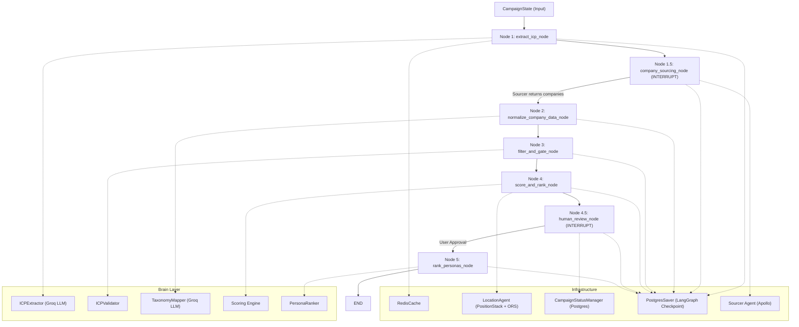

# Strategic Qualifier Pipeline

A LangGraph `StateGraph` that takes a natural-language campaign brief and produces a ranked shortlist of qualified companies with matched buyer personas.

The pipeline runs **6 nodes sequentially** with **2 interrupt points** for human-in-the-loop integration:
1. **Company sourcing interrupt** (Node 1.5) — pauses after ICP extraction to request companies from sourcer agent
2. **Human review interrupt** (Node 4.5) — pauses after company ranking for user approval before persona ranking

A **circuit breaker** (`pipeline_error`) halts all downstream processing on fatal failures — preventing the worst failure mode: an empty ICP silently qualifying every company and sending unqualified leads to sales reps.

---

## Architecture



---

## State Schema (`CampaignState`)

The state is the single source of truth passed between nodes. Each node returns a partial dict — LangGraph merges it into the state.

| Field | Type | Written By | Read By | Purpose |
|---|---|---|---|---|
| `icp_description_text` | `str` | Caller (input) | Node 1 | Raw campaign brief |
| `user_offering` | `str` | Caller (input) | — | Product/service description |
| `blacklist` | `BlacklistConfig` | Caller (input) | Node 3, Node 5 | `{companies: [...], personas: [...]}` |
| `configurable_weights` | `Dict[str, float]` | Caller (input) | Node 4, Node 5 | Dynamic weight overrides |
| `campaign_id` | `Optional[str]` | Caller (input) | All nodes (logging) | Audit trail identifier |
| `sourced_companies` | `List[Dict]` | Node 1.5 → Node 2 → Node 3 → Node 4 | Node 2, 3, 4, 5 | Companies flow through pipeline (starts empty) |
| `sourced_personas` | `List[Dict]` | Caller (input) | — | Raw persona data |
| `extracted_icp` | `Optional[ICPAttributes]` | Node 1 | Node 2, 3, 4, 5 | Structured ICP (Pydantic) |
| `filtered_companies` | `List[Dict]` | Node 3 | — | Surviving companies after gates |
| `nurture_companies` | `List[Dict]` | Node 4 | — | Below passing, above nurture |
| `ranked_companies` | `List[Dict]` | Node 4 | — | Qualified companies with scores |
| `ranked_personas` | `List[Dict]` | Node 5 | Output | Final scored contacts |
| `pipeline_error` | `Optional[str]` | Node 1 (on failure) | Node 2, 3, 4, 5 | Circuit breaker |
| `disqualification_log` | `Annotated[DisqualificationLog, reducer]` | Node 3, Node 4 | Output | Audit trail (additive reducer) |

---

## Node-by-Node Breakdown

### Node 1 — `extract_icp_node`

**Purpose:** Parse natural-language campaign brief → structured `ICPAttributes`

| | |
|---|---|
| **State Read** | `icp_description_text` |
| **State Write** | `extracted_icp`, `pipeline_error` (on failure) |
| **External** | `ICPExtractor` → Groq LLM (`llama-3.3-70b`), `RedisCache` |

**Data flow:**
1. Reads `icp_description_text` from state
2. Checks Redis cache (`icp_v4_clean` namespace)
3. If cache miss: sends prompt to Groq LLM → JSON response
4. Validator `clean()` — dedup lists, normalize tech stack, reconcile cities/countries
5. Constructs `ICPAttributes(**cleaned)` → caches `model_dump()` for 30 days
6. On failure: sets `pipeline_error` → all downstream nodes halt via circuit breaker

**ICP structure extracted:**

```
ICPAttributes
├── must_have (hard gates)
│   ├── industry: ["Insurance", "SaaS"]
│   ├── company_size: Range(min=100, max=10000)
│   ├── target_continents: ["Europe"]
│   └── target_countries: ["France", "Germany"]
├── nice_to_have (soft signals)
│   ├── revenue_range: Range(min=5M, max=80M)
│   ├── target_cities: [CityContext(city="Paris", country="France")]
│   ├── tech_stack: ["Python", "AWS"]
│   ├── growth_stage: "Series B"
│   └── funding_stage: null
├── exclude (rejections)
│   ├── industries: ["Gambling"]
│   ├── keywords: ["agency", "non-profit"]
│   └── company_size: Range(min=0, max=9)
└── target_roles: ["VP of Sales", "CTO"]
```

---

### Node 1.5 — `company_sourcing_node` (Interrupt Point)

**Purpose:** Pause pipeline after ICP extraction to request companies from sourcer agent

| | |
|---|---|
| **State Read** | `extracted_icp`, `pipeline_error` |
| **State Write** | `sourced_companies` |
| **External** | Sourcer Agent (Apollo), PostgresSaver (checkpoint) |

**Data flow:**
1. Receives `extracted_icp` from Node 1
2. **Interrupts** pipeline execution (LangGraph interrupt mechanism)
3. Builds `icp_filters` payload from ICP must-have attributes:
   - `industries` — list of target industries
   - `target_countries` — list of target countries
   - `target_continents` — list of target continents
   - `company_size` — min/max employee range
4. Sends payload to orchestrator via interrupt
5. Orchestrator calls sourcer agent with filters
6. Sourcer queries Apollo and returns raw company dicts
7. Orchestrator resumes pipeline with company list
8. Node writes `sourced_companies` to state

**Interrupt payload:**
```python
{
    "type": "company_sourcing_required",
    "icp_filters": {
        "industries": ["Insurance", "Fintech"],
        "target_countries": ["France", "Germany"],
        "target_continents": ["Europe"],
        "company_size": {"min": 500, "max": 20000}
    }
}
```

**Resume contract:**
- `List[Dict]` of raw Apollo company dicts → written to `sourced_companies`
- Empty list → pipeline logs warning, continues (Node 3 produces empty output)
- `None` → normalized to empty list to avoid crashes

**Why this interrupt exists:**
- Decouples pipeline from Apollo sourcer agent
- Allows sourcer to be a separate service/process
- Enables sourcer to use different authentication/rate limiting
- Makes pipeline testable with mock company data

---

### Node 2 — `normalize_company_data_node`

**Purpose:** Clean raw Apollo company dicts → standardized schema + LLM taxonomy mapping

| | |
|---|---|
| **State Read** | `pipeline_error`, `sourced_companies`, `extracted_icp`, `configurable_weights` |
| **State Write** | `sourced_companies` (overwritten with normalized data) |
| **External** | `TaxonomyMapper` → Groq LLM (one batch call) |

**Data flow:**
- **Circuit breaker:** if `pipeline_error` set → return `{}`
- **Per-record normalization** (never kills the batch — bad records return `None`):
  - JSON-parse stringified fields (`technologies`, `competitors`, `keywords`, `funding_events`)
  - Regex fallback for broken JSON (e.g., AXA's `technologies` field)
  - Null placeholder cleanup (`"non renseigné"`, `"N/A"` → `None`)
  - Int coercion for numeric fields (`employees`, `revenue`, `founded_year`)
  - Tech stack flattening (`[{name: "Python"}]` → `["Python"]`)
  - Subsidiary dedup: drops subsidiary if parent is also in batch
- **Taxonomy mapping:** one LLM call maps all raw industries to ICP taxonomy
  - e.g., `"Assurance et Services Financiers"` → `"Insurance"`
  - Never raises — falls back to identity mapping on failure

**Normalized company shape:**

```python
{
    "name", "apollo_id", "domain", "website_url",
    "industry_raw", "mapped_industry",     # industry_raw from vendor, mapped_industry from LLM
    "estimated_num_employees", "annual_revenue", "founded_year",
    "city", "country", "state",
    "latest_funding_stage", "funding_events",
    "tech_stack", "competitors", "departments", "keywords",
    "is_subsidiary", "parent_company", "suborganizations",
    "full_description", "short_description",
    "linkedin_url", "data_quality_score"
}
```

---

### Node 3 — `filter_and_gate_node`

**Purpose:** Cost-ordered defensive firewall — disqualify before expensive scoring

| | |
|---|---|
| **State Read** | `pipeline_error`, `extracted_icp`, `sourced_companies`, `blacklist`, `campaign_id` |
| **State Write** | `filtered_companies`, `sourced_companies` (survivors), `disqualification_log` |
| **External** | None (all checks are free) |

**Gate order (cheapest first):**

```
Company enters gate
    │
    ▼
CHECK 1: Blacklist match? ──YES──→ Disqualify (BLACKLIST_MATCH)
    │ NO
    ▼
CHECK 2: Must-have industry? ──NO──→ Disqualify (MUST_HAVE_INDUSTRY_MISS)
    │ YES
    ▼
CHECK 3: Must-have size range? ──NO──→ Disqualify (MUST_HAVE_SIZE_MISS)
    │ YES (within ±10% tolerance)
    ▼
CHECK 4: Exclude criteria? ──YES──→ Disqualify (EXCLUDED_INDUSTRY/KEYWORD/SIZE)
    │ NO
    ▼
PASS → Added to valid_companies
```

**Size filtering tolerance:**
- Must-have size gate now uses ±10% tolerance (configurable via `near_miss_band`)
- Companies within 450-22000 employees (for ICP 500-20000) pass to scoring
- Outside tolerance → disqualified with `MUST_HAVE_SIZE_MISS`
- Enables more accurate scoring by allowing near-miss companies to proceed

**Exclude criteria (Check 4)** scans 3 sub-layers:
1. **Industry exclusion** — checks `industry_raw`, `mapped_industry`, AND full description text
2. **Keyword exclusion** — scans company name + description for banned terms
3. **Size exclusion** — rejects companies within a banned headcount range

---

### Node 4.5 — `human_review_node` (Interrupt Point)

**Purpose:** Pause pipeline for human approval before persona ranking

| | |
|---|---|
| **State Read** | `ranked_companies`, `extracted_icp`, `campaign_id` |
| **State Write** | `ranked_companies` (filtered by user approval) |
| **External** | `CampaignStatusManager` (Postgres) |

**Data flow:**
1. Receives `ranked_companies` from Node 4
2. **Interrupts** pipeline execution (LangGraph interrupt mechanism)
3. Calls `CampaignStatusManager.set_awaiting_approval()` to persist state
4. Stores `ranked_companies` in database as JSONB for frontend rendering
5. Waits for user to approve/decline companies via API
6. On resume: filters `ranked_companies` to user-approved subset
7. Calls `CampaignStatusManager.set_resuming()` before Node 5 executes

**Database persistence:**
- Campaign status: `awaiting_approval`
- `ranked_companies` stored as JSONB for UI restoration
- Frontend can query `get_pending_for_user()` on app reopen

---

### Node 4 — `score_and_rank_node`

**Purpose:** Geo-filter → firmographic scoring → LLM intent → composite tier assignment

| | |
|---|---|
| **State Read** | `pipeline_error`, `extracted_icp`, `sourced_companies`, `configurable_weights`, `campaign_id` |
| **State Write** | `sourced_companies` (ranked only), `ranked_companies`, `nurture_companies`, `disqualification_log` |
| **External** | `LocationAgent` (PositionStack + ORS), Scoring Engine, LLM (intent analysis) |

**Execution order:**

```
Geo-filtered companies
    │
    ▼
STEP 1: Geospatial Filtering (LocationAgent)
    ├── Continent filter (skipped if target_countries set)
    ├── Country filter
    └── City-proximity filter (PositionStack geocode → ORS distance matrix)
        └── Fallback: country-only if APIs fail
    │
    ▼
STEP 2: Firmographic Scoring (per company)
    ├── Industry fit: 20% label match + 80% LLM semantic verification
    ├── Size fit: binary pass/fail within range
    ├── Revenue fit: binary pass/fail within range
    └── Tech stack fit: bidirectional fuzzy substring matching (improved from exact intersection)
    │
    ▼
    Dynamic weight blending → firmographic_score (0-100)
    │
    ▼
STEP 3: Intent Gate
    ├── firm_score >= passing_threshold (default 50) → LLM intent analysis
    └── firm_score < threshold → skip LLM, score conservatively (intent=0)
    │
    ▼
STEP 4: Composite Synthesis
    total_score = (firm_score × 0.60) + (intent_score × 0.40)
    │
    ├── total >= 80 → Tier A
    ├── total >= 50 → Tier B
    └── total < 50  → Tier C
    │
    ▼
STEP 5: Bucket Assignment
    ├── firm_score >= passing_threshold → ranked_list (qualified)
    ├── firm_score >= nurture_threshold → nurture_list (promising)
    └── firm_score < nurture_threshold → discard (logged)
```

**Configurable thresholds** (from `FirmographicWeights`):

| Parameter | Default | Purpose |
|---|---|---|
| `passing_threshold` | `50.0` | Minimum firm score to trigger LLM intent + qualify |
| `nurture_threshold` | `25.0` | Minimum firm score for nurture bucket |
| `max_km_radius` | `50.0` | Max distance from target city for proximity filter |
| `near_miss_band` | `0.10` | ±10% tolerance for size/revenue bounds in filtering |
| `near_miss_penalty` | `0.20` | 20% score penalty for near-miss values (80 vs 100) |

---

### Node 5 — `rank_personas_node`

**Purpose:** Score and rank buyer personas inside user-approved companies

| | |
|---|---|
| **State Read** | `pipeline_error`, `sourced_companies` (ranked only, user-approved), `extracted_icp`, `blacklist`, `configurable_weights` |
| **State Write** | `ranked_personas` |
| **External** | `PersonaRanker` (dual-axis matrix + LLM signal analysis), `CampaignStatusManager` (on completion) |

**Per-company persona scoring:**

```
Raw personas from company
    │
    ▼
Persona blacklist check → skip if matched
    │
    ▼
Dual-Axis Matrix Scoring:
    ├── Axis A: Functional Relevance (role match → 100, dept match → 75, CEO → 50, else → 0)
    └── Axis B: Seniority/Authority (C-level → 100, VP → 90, Director → 80, Manager → 50)
    │
    ▼
Modifiers:
    ├── Email domain verification (+15)
    ├── Phone presence (+5)
    ├── Tenure trigger: 1-3 months in role (+10)
    ├── LLM public signal analysis (+10, only if functional_score >= 50)
    └── LinkedIn connection boost (+10)
    │
    ▼
Composite: base_matrix × user_weight + modifiers × (1 - user_weight)
    │
    ▼
CEO Fallback (startups only: headcount < 20, no scored personas)
    → Injects synthetic CEO anchor with fallback scoring
    │
    ▼
Sort by persona_score descending → attach to company as ranked_target_leads
```

---

## Disqualification Log (Audit Trail)

Uses a LangGraph reducer (`reduce_disqualification_log`) with `Annotated[DisqualificationLog, reduce_disqualification_log]`. Node 3 and Node 4 can each return their own `disqualification_log`, and LangGraph **additively merges them** (combines records, sums counters, merges summary dicts).

```
DisqualificationLog
├── total_evaluated: int
├── total_passed: int
├── total_disqualified: int
├── records: [DisqualificationRecord, ...]
│   └── Each record: entity_type, entity_name, entity_id, reason_code, reason_detail, firm_score, timestamp, campaign_id
└── summary: {"BLACKLIST_MATCH": 2, "MUST_HAVE_INDUSTRY_MISS": 5, ...}
```

---

## Campaign Lifecycle & Database Persistence

The pipeline now supports human-in-the-loop workflow with persistent state storage across two separate Postgres schemas:

### Three-Phase Execution

**Phase 1 (Node 1):** ICP extraction
- Runs automatically on campaign creation
- Extracts structured ICP from natural language brief
- Ends at Node 1.5 interrupt point
- Status: `running`

**Phase 2 (Nodes 1.5-4):** Company sourcing, normalization, filtering, ranking
- Orchestrator receives ICP filters from Node 1.5 interrupt
- Calls sourcer agent to query Apollo
- Resumes pipeline with raw companies
- Nodes 2-4 process and rank companies
- Ends at Node 4.5 interrupt point
- Status: `running` → `awaiting_approval`

**Phase 3 (Node 5):** Persona ranking for approved companies
- User approves/declines companies via frontend
- Orchestrator sends approved IDs to sourcer for personas
- Resumes pipeline with persona data
- Node 5 ranks personas for approved companies only
- Status: `resuming` → `completed` or `failed`

### Database Schemas

**1. LangGraph Checkpoint Tables** (managed by `PostgresSaver`)
- `checkpoints` — pipeline state snapshots at each node
- `checkpoint_writes` — state deltas
- Automatically created by `setup_postgres_setup.py`
- Used by LangGraph for resume/rollback functionality

**2. Application Campaign Table** (managed by `CampaignStatusManager`)
- `campaigns` — custom application-level tracking
- Created by `setup_compaign_status_table.py`
- Schema:
  ```sql
  campaign_id         TEXT PRIMARY KEY  -- bridges to LangGraph thread_id
  user_id             TEXT NOT NULL     -- campaign owner
  status              TEXT NOT NULL     -- running|awaiting_approval|resuming|completed|failed
  ranked_companies    JSONB             -- stored for UI restoration (awaiting_approval only)
  usage               JSONB             -- token usage tracking data (per-node breakdown)
  error_message       TEXT              -- populated if status=failed
  icp_description     TEXT              -- campaign context
  created_at          TIMESTAMPTZ
  updated_at          TIMESTAMPTZ
  ```

### Campaign Status Manager API

```python
from graph.campaign_status import CampaignStatusManager, CampaignStatus

manager = CampaignStatusManager()

# Lifecycle operations
manager.create(campaign_id, user_id, icp_description)           # status = 'running'
manager.set_awaiting_approval(campaign_id, ranked_companies)     # status = 'awaiting_approval'
manager.set_resuming(campaign_id)                                # status = 'resuming'
manager.set_completed(campaign_id)                               # status = 'completed'
manager.set_failed(campaign_id, error_message)                   # status = 'failed'

# Query operations
manager.get(campaign_id)                                         # fetch single campaign
manager.get_pending_for_user(user_id)                            # fetch awaiting_approval campaigns
manager.get_all_for_user(user_id)                                # fetch all campaigns (history view)
```

### Resume Flow

**Phase 1 → Phase 2 (Company Sourcing):**
1. Node 1 completes ICP extraction
2. Node 1.5 interrupts with `icp_filters` payload
3. Orchestrator receives payload, calls sourcer agent with filters
4. Sourcer queries Apollo, returns raw company dicts
5. Orchestrator resumes pipeline with `Command(resume=companies)`
6. Pipeline continues to Node 2

**Phase 2 → Phase 3 (Human Review):**
1. Frontend calls `get_pending_for_user(user_id)` on app open
2. If campaign found with `status='awaiting_approval'`:
   - Display approval UI with stored `ranked_companies`
   - User selects companies to approve/decline
3. Frontend sends approval to orchestrator
4. Orchestrator calls `set_resuming()` then resumes LangGraph with approved IDs
5. Node 5 processes only approved companies
6. On completion: `set_completed()` or `set_failed()`

---

## Circuit Breaker Pattern

```
Node 1 fails → sets pipeline_error
    │
    ├── Node 2 checks pipeline_error → returns {} (halt)
    ├── Node 3 checks pipeline_error → returns {} (halt)
    ├── Node 4 checks pipeline_error → returns {} (halt)
    └── Node 5 checks pipeline_error → returns {} (halt)
```

This prevents the worst failure mode: an empty ICP silently qualifying every company and sending unqualified leads to sales reps.

---

## Recent Improvements

### Usage Tracking Integration

**Previous behavior:** No token usage tracking
- LLM calls executed without monitoring token consumption
- No visibility into cost per campaign
- Difficult to optimize for cost efficiency

**New behavior:** Comprehensive token usage tracking
- `UsageAccumulator` captures token counts per node
- `GroqUsageCallback` automatically tracks LLM token usage
- Per-node breakdown: extract_icp, score_and_rank, rank_personas, etc.
- Aggregate totals: total_tokens, total_tokens_in, total_tokens_out, total_llm_calls
- Stored in database `usage` column as JSONB on campaign completion
- Configurable via `state['configurable_weights']` for runtime overrides

**Implementation:**
- `utils/usage_tracker.py` - Core tracking infrastructure
- Integrated into `graph/nodes.py` for key pipeline nodes
- MCP server (`qualifier_mcp/server.py`) captures and persists usage on completion
- Unit tests in `tests/test_usage_tracking.py` validate tracking accuracy

**Usage data structure:**
```json
{
  "campaign_id": "uuid",
  "per_node": [
    {
      "node_name": "extract_icp",
      "llm_calls": 1,
      "tokens_in": 100,
      "tokens_out": 50,
      "total_tokens": 150
    }
  ],
  "combined": {
    "total_tokens": 675,
    "total_tokens_in": 450,
    "total_tokens_out": 225,
    "total_llm_calls": 3
  },
  "errors": []
}
```

### Size Filtering Tolerance

**Previous behavior:** Exact range matching in hard gate
- Companies outside exact ICP size range disqualified immediately
- No opportunity for near-miss companies to be scored
- ±10% tolerance only applied during scoring (too late)

**New behavior:** ±10% tolerance in hard gate
- Must-have size gate uses configurable tolerance (default ±10%)
- Companies within tolerance pass to scoring for accurate evaluation
- Near-miss penalty applied during scoring (80 vs 100)
- Configurable via `near_miss_band` parameter in `FirmographicWeights`

### Overall Match Quality Label

**Previous behavior:** No company-level match quality label
- Per-feature match_quality existed in breakdown
- No consolidated label for frontend display
- UI had to compute overall match from breakdown

**New behavior:** Company-level match quality for UI badges
- `calculate_overall_match_quality()` function in `brain/scoring.py`
- Converts per-feature breakdown into single label
- Labels: `perfect_match`, `similar_to_icp`, `partial_match`, `poor_match`
- Added to `qualification_metrics.overall_match` in ranked company output
- Frontend can display match badges without additional computation

**Match quality logic:**
- `perfect_match` - All features are exact matches
- `similar_to_icp` - 75%+ features are exact or near_miss
- `partial_match` - Mixed exact/near_miss/miss
- `poor_match` - 50%+ features are misses

### Human-in-the-Loop Workflow

**Previous behavior:** Single-pass execution with no user intervention
- All nodes ran sequentially from start to finish
- No ability to review or modify company rankings before persona ranking
- Companies had to be provided upfront in initial state

**New behavior:** Three-phase execution with two interrupt points
- Phase 1 (Node 1): ICP extraction
- Interrupt at Node 1.5 for company sourcing from Apollo
- Phase 2 (Nodes 1.5-4): Company normalization, filtering, ranking
- Interrupt at Node 4.5 for human review
- User approves/declines companies before persona ranking
- Phase 3 (Node 5): Persona ranking only for approved companies
- Full state persistence across sessions via Postgres

### Company Sourcing Decoupling

**Previous behavior:** Companies provided in initial state
- Caller had to source companies before invoking pipeline
- Tight coupling between pipeline and Apollo sourcer
- Difficult to test with mock data

**New behavior:** Company sourcing via interrupt point
- Node 1.5 interrupts after ICP extraction
- Orchestrator receives structured ICP filters
- Calls sourcer agent separately to query Apollo
- Resumes pipeline with raw company data
- Enables sourcer to be independent service with own auth/rate limiting
- Makes pipeline fully testable with mock company data

---

## MCP Server Integration

The pipeline is now exposed via a Model Context Protocol (MCP) server for orchestrator integration. The MCP server (`qualifier_mcp/`) wraps the LangGraph pipeline and CampaignStatusManager into 5 callable tools.

### MCP Server Architecture

**Implementation:** FastMCP framework with stdio transport
- Server runs as subprocess spawned by MCP client (e.g., Claude Desktop, orchestrator)
- Communicates via JSON-RPC over stdin/stdout
- Auto-generates tool schemas from function signatures and Pydantic models

**Location:** `qualifier_agent/qualifier_mcp/`
- `server.py` - FastMCP server with 5 tools
- `schemas.py` - Pydantic models for tool inputs/outputs
- `run.py` - Entrypoint for spawning the server

### Available Tools

**Tool 1: `start_campaign`**
- **Purpose:** Phase 1 - ICP extraction, pauses for company sourcing
- **Input:** `user_id`, `icp_description_text`, `user_offering`, `blacklist`, `configurable_weights`
- **Output:** `campaign_id`, `status`, `icp_filters` (for sourcer agent)
- **Database:** Creates campaign row with status='running'

**Tool 2: `resume_with_companies`**
- **Purpose:** Phase 2 - Company normalization, filtering, ranking, pauses for human review
- **Input:** `campaign_id`, `sourced_companies` (raw Apollo dicts from sourcer)
- **Output:** `ranked_companies`, `nurture_companies`, `disqualification_summary`
- **Database:** Updates status='awaiting_approval', stores ranked_companies as JSONB

**Tool 3: `resume_with_approvals`**
- **Purpose:** Phase 3 - Persona ranking for approved companies
- **Input:** `campaign_id`, `approved_apollo_ids`, `sourced_personas_by_company`
- **Output:** `ranked_personas`, `total_personas_ranked`
- **Database:** Updates status='completed'

**Tool 4: `get_campaign_status`**
- **Purpose:** Read current campaign state
- **Input:** `campaign_id`
- **Output:** `status`, `user_id`, `ranked_companies`, `icp_description`, `error_message`, timestamps

**Tool 5: `get_pending_campaigns`**
- **Purpose:** Frontend uses on app open to restore UI state
- **Input:** `user_id`
- **Output:** List of campaigns with status='awaiting_approval' + ranked_companies

### Orchestrator Flow

```
Orchestrator → start_campaign(icp_text)
                ↓
            Returns: campaign_id + icp_filters
                ↓
Orchestrator → Sourcer Agent (Apollo)
                ↓
            Returns: raw_companies
                ↓
Orchestrator → resume_with_companies(campaign_id, raw_companies)
                ↓
            Returns: ranked_companies
                ↓
Frontend → User approves/declines companies
                ↓
Orchestrator → Sourcer Agent (personas for approved IDs)
                ↓
            Returns: sourced_personas_by_company
                ↓
Orchestrator → resume_with_approvals(campaign_id, approved_ids, personas)
                ↓
            Returns: ranked_personas
```

### Testing

**Test file:** `qualifier_agent/tests/test_mcp_server.py`
- Uses FastMCP Client to spawn server as subprocess
- Calls all 5 tools in correct orchestrator sequence
- Validates status transitions and data flow
- Verifies database state after each phase

**Run test:**
```bash
python qualifier_agent/tests/test_mcp_server.py
```

### Benefits of MCP Integration

- **Decoupling:** Pipeline and orchestrator communicate via well-defined protocol
- **Type safety:** Pydantic schemas ensure contract compliance
- **Testability:** MCP client can test server end-to-end without orchestrator
- **Extensibility:** New tools can be added without breaking existing clients
- **Language agnostic:** Orchestrator can be any language with MCP client support

---

## LLM Call Inventory (Cost Awareness)

| Call | Model | Where | Frequency |
|---|---|---|---|
| ICP Extraction | Groq `llama-3.3-70b` | Node 1 (extractor) | 1x per campaign (cached 30d) |
| Industry Taxonomy | Groq `llama-3.3-70b` | Node 2 (taxonomy_mapper) | 1x batch per normalization |
| Industry Verification | Groq `llama-3.3-70b` | Node 4 (scoring) | 1x per geo-filtered company |
| Intent Analysis | Groq `llama-3.3-70b` | Node 4 (scoring) | 1x per company that passes firm threshold |
| Persona Signals | Groq `llama-3.3-70b` | Node 5 (persona_ranker) | 1x per persona with `functional_score >= 50` |

Gate ordering ensures expensive LLM calls only run on companies that survived all free checks.